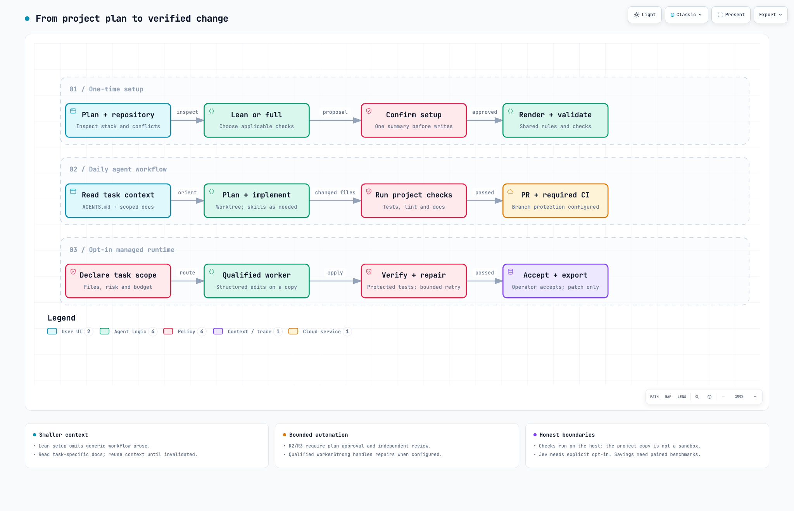
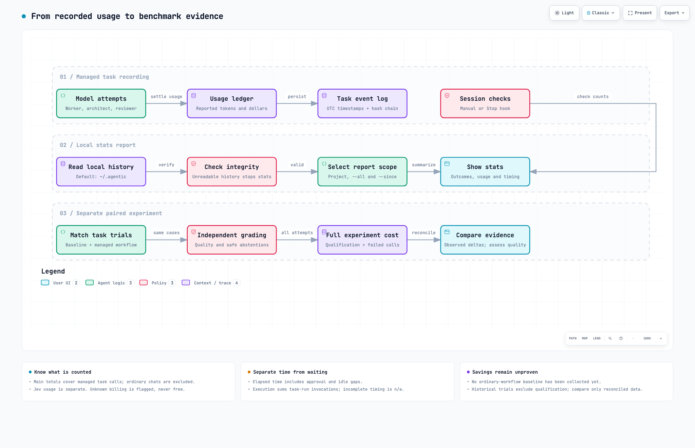

# Startup agentic boilerplate

## What is this?

It sets up a new or existing software project with shared agent instructions and executable checks. Checks provide evidence; they do not prove a change is correct or sandbox candidate code.

You give it a plan. It builds the project's rule book and safety checks:

- **Rules for agents** (`AGENTS.md`): what the product is, what must never break, where code goes.
- **Docs the agent reads only when needed** (`context/`): architecture, standards, glossary, build plan, progress.
- **Checks that run by themselves**: lint, docs links, dead code, branch and commit names, CI.
- **Skills** the agent can call: plan a feature, review it, recover when stuck, remember, and more.

It has two parts. You can use the first without the second.

| Part | What it does | Needs |
| --- | --- | --- |
| **1. Setup skill** (`project-setup`) | Writes the rules, docs and checks into your project. | Claude Code, Codex, or another coding harness; Node 22+ (or Bun). No keys, no model setup. |
| **2. Optional runtime** (`agentic`) | Lets an AI *propose* code while a program *runs the tests and keeps the proof*. The AI cannot say "it works". Only the checks can. | Node 22.18+. A model of your choice. |

## Setup and execution at a glance

Direct development is the default. Choose lean or full setup, then use the shared project checks in your normal workflow. The optional runtime adds scoped model actions, bounded repair and explicit acceptance before patch export.

<picture>
  <source media="(prefers-color-scheme: dark)" srcset="docs/agentic-setup.visual-check.2048x1320.dark.png">
  <source media="(prefers-color-scheme: light)" srcset="docs/agentic-setup.visual-check.2048x1320.light.png">
  
</picture>

[Interactive workflow](docs/agentic-setup.html) · [Editable diagram source](docs/agentic-setup.workflow.json)

The previews follow your light/dark theme. Download the HTML and open it locally for zoom, search and node details; GitHub displays HTML as source.

## Quick start

```bash
git clone <this repo> && cd startup-agentic-boilerplate
./install.sh --global --link          # for every project, edits here apply at once
# or: ./install.sh ~/apps/my-project  # only inside one project
```

The installer writes `.agents/skills/project-setup` and creates a `.claude/skills/project-setup`
symlink to it. Existing installations are never overwritten; move an old Claude-only install
aside before reinstalling. `--link` makes the canonical directory a symlink to this checkout.

Then, in an empty folder (or an existing repo), invoke the skill in your harness:

```
/project-setup ./plan.md       # Claude Code
$project-setup ./plan.md      # Codex
```

Other harnesses can read `project-setup/SKILL.md` from the installed directory and follow it
with your plan. Generated rules and skills are shared; Claude settings are optional.
Run the documented checks before handoff in every harness; only Claude has the generated Stop hook.

Or paste the plan. The skill asks only what it cannot work out, shows **one summary**, waits for your yes, then writes everything,
fills in the blanks from your plan, runs the checks, and ends with your first task.

Already have code? Same command. It looks at your project first and fits itself to it (see "Existing projects").

## Rules for setting up

Follow these. The skill does most of them for you.

1. **Start from a plan** (a file or pasted text). Nothing is invented: unknowns become open questions in `context/build-plan.md`.
2. **Use a clean git state.** Commit or stash first, so you can undo with one command.
3. **Nothing is overwritten.** Files that already exist are skipped and listed, and you merge them by hand. `--force` is only for you, never the agent.
4. **You confirm once.** The skill shows one summary before it writes anything. Say no, and nothing is written.
5. **Preview first** if you run the renderer yourself: add `--dry-run`. It shows what it would create and what conflicts.
6. **Never put secrets in the plan or the answers file.** The answers file is saved at `docs/archive/project-setup.answers.json` and committed. Keys go in the places below.
7. **Fill every `<!-- FILL: … -->` marker.** `node scripts/checks/docs-check.mjs` fails until none are left.
8. **Run the checks before you call it done:** `node scripts/checks/docs-check.mjs`, then the project's lint, typecheck and tests.
9. **Turn on branch protection on GitHub.** The workflow files alone do not stop a merge. Make the checks "required". Check it with `node project-setup/scripts/protection.mjs`. It reports PROTECTED, INCOMPLETE, UNPROTECTED or UNKNOWN. PROTECTED requires the named checks, strict status checks, and no observed bypass settings; use `--checks` for custom job names. (GitHub's free plan cannot set it on a private repo.)
10. **The runtime is off unless you ask.** Choose it during setup, or later (see "Turn the runtime on or off").
11. **To update later,** run `/project-setup` again. Files you did not edit are updated. Files you edited are left alone. Files changed on both sides go to `.project-setup/sync/` for you to merge.
12. **Setup hits a bug or a confusing rule in this tool?** Report it. See "Found a problem?" below.

## Lean setup

For small projects, select `flags.LEAN: true` in the answers file. This writes concise instructions, a code map, build plan, progress log and library links, plus the applicable hooks and CI. Generic domain architecture, workflow skills and fallow configuration are omitted. Existing tools stay in place; add topic docs and skills only when needed. Full setup remains available for projects that need it.

## Existing projects

The skill reads your repo first (package manager, apps, linter, hooks, CI, agent docs). Then it adapts:

- Your linter, hooks and CI **stay**. The new checks are added to them.
- Differential lint and dead-code checks can judge new code. Full tests and the runtime's default `require-pass` baseline can still block on pre-existing failures.
- `context/plans/adoption.md` lists the old problems and optional clean-ups. Nothing is moved unless you ask.
- Your `AGENTS.md`, `CLAUDE.md` and `.claude/settings.json` are merged, never replaced.

## Working in a project that was set up (daily rules)

- **Branches:** `<type>/<kebab-name>`, for example `feat/add-login`. Types: feat, fix, docs, refactor, perf, test, build, ci, chore, revert.
- **Commits and PR titles:** `type(scope): short summary`, lowercase, at most 72 characters.
- **Never push to the main branch** by default. Use a branch and a PR. Never use `--no-verify`.
- **One worktree per task.** Worktrees live next to the repo in `<repo>.worktrees/<branch-with-dashes>`. One worktree = one branch = one PR.
  `node scripts/git/worktrees.mjs new feat/add-login` makes one. `list` shows them. `clean` removes only the finished ones (merged, pushed, no changes).
  `doctor` finds stale ones. Nothing is ever force-deleted. Full rules: `context/standards/delivery.md#worktrees`.
- **PRs stay `do-not-merge`** until the checks are green and recorded in the PR body.

## The optional runtime (`agentic`)

**The idea:** an AI proposes small changes. A normal program applies them, runs the real tests, and records the proof. A person says yes at the end.
The AI cannot approve its own work.

```bash
node scripts/agentic.mjs doctor                      # shows OFF until explicitly enabled
node scripts/agentic.mjs enable                      # only for a chosen managed task
node scripts/agentic.mjs do "fix the bug" --files src/example.ts # existing files, derive a task
node scripts/agentic.mjs task create task.json       # describe one task
node scripts/agentic.mjs task run <id>               # run it on a COPY of your project
node scripts/agentic.mjs task accept <id>            # accept the verified candidate
node scripts/agentic.mjs task export <id>            # get a patch to apply yourself
node scripts/agentic.mjs stats                       # usage, cost, outcomes
```

What it will and will not do:

- Model edits target a **copy** and export as a patch. Checks run on the host as your user; the copy and scratch HOME are not a security sandbox. The task controller does not commit, push, merge or deploy.
- Approve plans and accept verified results with explicit commands, from your terminal or an authorized agent in chat. No interactive prompts.
- Risky work (login, money, migrations, CI, dependencies) needs an approved plan and a review. Edits outside the approved write scope are rejected; an out-of-scope final diff stops for a new contract. Existing conventional tests are frozen by default, including colocated tests; add custom acceptance paths to `protectedPaths`. Changing these controls needs maintenance authorization.
- A task that cannot be done safely **stops and says why**. It does not guess.

### Turn the runtime on or off

- **At setup:** `AGENTIC_RUNTIME` installs the optional runtime. Execution and automatic full session checks remain off.
- **Switch:** `"enabled"` in `.agents/policy.json`. Missing = **off**. `node scripts/agentic.mjs disable` turns it off. `enable` turns it on.
  When off, tasks and model probes refuse to run. Direct coding, normal project checks and CI remain the daily workflow.
- **Automatic full checks:** separately opt in with `"sessionChecks": true`. Explicit `session-check` works even when managed execution is off.

### Avoid repeating work in managed tasks

Run `task preflight <id>` before execution; context must fit the selected budget before any dependency installation.
Planning uses the same context allowance as the worker (4k/8k/16k estimated tokens for narrow/standard/complex).
Put an existing agreed plan in the contract’s `plan` field to skip architect generation; R2/R3 still require explicit
plan approval and independent review. Final edits can use `edit_and_finish` to avoid a separate finish exchange.

Use `task revise <id> <contract.json>` to correct context, scope, plan or total limits on the same task.
It keeps the prepared candidate, baseline and all usage; revised R2/R3 tasks require fresh approval and verification.
Normal presets allow one/two/three semantic repairs; an unchanged repeated failure still stops immediately.
Prepare the starting project’s lint/docs/tests once before opting in; a failed initial environment is not reusable.

### Models and keys

- The generated `.agents/models.json` uses `execution: "handoff"` and defaults to manual packet exchange for any model/harness. Pick a provider from `.agents/models.example.json` (Claude CLI, Ollama, a chat API, or manual copy-paste). **No keys in this file.** Manual exchange also needs hosted-egress consent; for local-only runs, select a local provider.
- Hosted models (anything off your machine) only run if `.agents/policy.json` says `"egress": "hosted-allowed"`. Default is `local-only`.
- Worker qualification: `node scripts/agentic.mjs qualify <profile>` tests JSON actions. Architecture/review need separate evidence or an explicit owner declaration.
- Your chat's model/reasoning selection is not inherited by delegated providers. `doctor` and `task preflight <id>` show actual routes and qualification sources; external routes require `execution: "delegated"`.
- **Existing projects:** use the [routing upgrade command](docs/migration-guide.md#model-routing-and-pre-edit-budget-upgrade) after pulling the runtime. It backs up configuration, preserves policy/history and re-pins. Follow the [current-chat handoff guide](packages/agent-runtime/README.md#using-your-current-chat) to answer packets without launching a different model.

### Jev (optional)

- Put your key in `~/.agentic/secrets.env` (one line: `JEV_API_KEY=...`, file mode `600`). It is **per user and outside every repo**. A group-readable file is refused.
- Jev is **off by default even when a key exists**. Opt in with explicit `jev.modes` or `"jev": { "auto": true }` for workflow routing only. Skill selection and retrieval shadow experiments require explicit modes; their benefit is unproven.
- Workflow routing sends the goal, acceptance criteria, file names and risk tier only when `egress` is `hosted-allowed`. Explicit retrieval experiments can send source excerpts and additionally require `allowSource`.
- It is optional. Nothing needs it.

### Where things are stored

- Task history, proof and stats: `~/.agentic/tasks/` (change with `AGENTIC_HOME`). Per user, kept over time, never in the repo.
- `node scripts/agentic.mjs session-check` explicitly reruns checks. The Stop hook requests these only when both `enabled` and `sessionChecks` are true. `--reuse` is an explicit opt-in for a previous successful result with matching source and gate configuration; use it only when dependencies and external services have not changed.
- `node scripts/agentic.mjs stats [--all] [--since 30d]` shows tasks, verified results, cost and time. It shows **measured** spend only. It does not claim "savings", because that needs a before/after test.

## Check your usage and stats

From the root of a project with the runtime enabled:

```bash
node scripts/agentic.mjs stats                 # this project's task history
node scripts/agentic.mjs stats --since 30d     # tasks created in the last 30 days
node scripts/agentic.mjs stats --all           # all your projects in the same controller home
node scripts/agentic.mjs stats --json          # machine-readable report
```

Stats reads local history without making model calls. It records managed task usage, not ordinary Codex/Claude chat usage. Elapsed time includes approval waits; task-run execution time excludes gaps between invocations. Unknown billing is flagged, and unreadable history stops the report rather than silently reducing the totals.

For storage paths, JSON fields, date-filter semantics, empty reports and recovery guidance, see [Checking your stats](packages/agent-runtime/README.md#checking-your-stats). Measured spend is not measured savings; those require a [paired benchmark](docs/evaluation.md#paired-workflow-benchmark).

<picture>
  <source media="(prefers-color-scheme: dark)" srcset="docs/agentic-stats.visual-check.2048x1320.dark.png">
  <source media="(prefers-color-scheme: light)" srcset="docs/agentic-stats.visual-check.2048x1320.light.png">
  
</picture>

[Interactive stats and benchmark map](docs/agentic-stats.html) · [Editable diagram source](docs/agentic-stats.workflow.json)

Task totals exclude ordinary chats and standalone qualification. Elapsed time includes approval waits; execution timing measures controller invocations. The separate evaluation account includes qualification and failed calls. A comparable ordinary-workflow baseline still needs to be collected.

## Found a problem?

If setup (or this tool) is **wrong, broken or inconsistent**, tell this repo. The agent following the skill should do it for you, as you allowed at setup (`auto`, `ask`, or `off`):

| How bad | Example | What happens |
| --- | --- | --- |
| **Important** | Setup crashes. A generated file is broken. A check wrongly passes or fails on a clean project. A secret could be committed. A guard is weaker than the docs say. | A **pull request** with the fix and a test. Never merged by the agent. |
| **Moderate** | Docs and behavior disagree. A rule is unclear or conflicting. A default is wrong but has a workaround. | An **issue**. |
| **Minor** | A typo or wording. | Mentioned in the summary only. |
| **Security hole** | Something an attacker could use. | Tell the owner directly. Nothing public. |

Your project's private details (plan, names, paths, keys) are **never** included. The repo is private, so you need access to open a PR or issue. Without it, the agent writes a
redacted note to `docs/archive/upstream-report-<date>.md` for you to pass on. Full steps: [project-setup/references/upstream-reporting.md](project-setup/references/upstream-reporting.md).

## What a generated project gets

```
AGENTS.md · CLAUDE.md · README.md · .env.example · .gitignore
context/        project overview, glossary, code map, architecture, standards, UI rules, build plan, progress tracker, decisions
docs/           local setup · your plan, unchanged
.agents/        skills (architect, review, recover, remember, imprint, add-library-skill, stats*) · routines · skills index
                policy.json · models.example.json * (runtime only)
.claude/        settings with a Stop hook that runs the checks and sends failures back to the agent
.githooks/ + scripts/git/       branch, commit and PR-title rules · worktrees.mjs
scripts/checks/                 docs-check · (trusted-gates *)
.github/        ci.yml · merge-gate.yml (do-not-merge) · agentic-verify.yml * · PR template · dependabot
biome.json · .fallowrc.json · tsconfig.base.json     TypeScript projects only
                                                      (* only when the runtime is on)
```

Files depend on your choices (UI, Next.js, database, auth, multi-tenant, AI, jobs, GitHub, TypeScript), so a small or non-TypeScript project gets only what applies.

## What is checked, and what is not

**Tested:** the renderer and all setup variants, the install script, the runtime and audit regressions, type checking, formatting, the architecture check, worktree safety, and real
runs with Claude Haiku (small samples).

**Not tested or not proven:** Ollama or Codex against a real model, GitHub branch protection on this repo (the free plan cannot set it), success rates beyond small samples, and "savings".
Details and numbers: `docs/evaluation.md`, `docs/jev.md`, `docs/learning.md`, `docs/threat-model.md`.

## This repo

```
project-setup/       the skill: SKILL.md · references/ · templates/ (what gets written) · scripts/ (renderer, detector, protection check)
packages/agent-runtime/   the optional runtime (TypeScript; core uses Node built-ins)
schemas/             JSON Schemas for policy, task, model and architecture files
evals/               test cases with hidden graders · baselines/ saved results
docs/                threat model · evaluation · Jev · learning · migration · provider contract
test/                tests for the renderer, installer, variants, launcher, CI check, worktrees
install.sh · biome.json
```

### Working on this repo

```bash
npm ci --prefix packages/agent-runtime
npm run verify    # setup + runtime tests, typecheck, lint, format, architecture
```

A rule that proved itself in a real project: add it to `project-setup/templates/` or `project-setup/references/invariants-catalog.md`, with a test.

### Measuring improvements

Use the paired evaluation procedure in [docs/evaluation.md](docs/evaluation.md). Compare independently graded results with
`node packages/agent-runtime/scripts/compare-evals.ts baseline.json candidate.json`. Include qualification, failed calls,
wall time and human intervention. The repository contains historical small development samples, not a proof of net savings.

### Diagram maintenance

The two workflow diagrams are generated with [Archify](https://github.com/tt-a1i/archify) from the committed `docs/agentic-*.workflow.json` specifications. When behavior changes, update the relevant specification, run Archify `validate` and `deliver`, then `visual-check` and review both themes. Refresh the PNG previews and receipt together; do not edit the generated HTML by hand. Archify is an authoring tool, not a project runtime dependency.

Delivery hashes and validation summaries: [setup receipt](docs/agentic-setup.receipt.json) and [stats receipt](docs/agentic-stats.receipt.json). Browser checks cover four desktop sizes; perceptual review is recorded separately. These checks validate the diagrams, not the runtime's correctness or savings.
